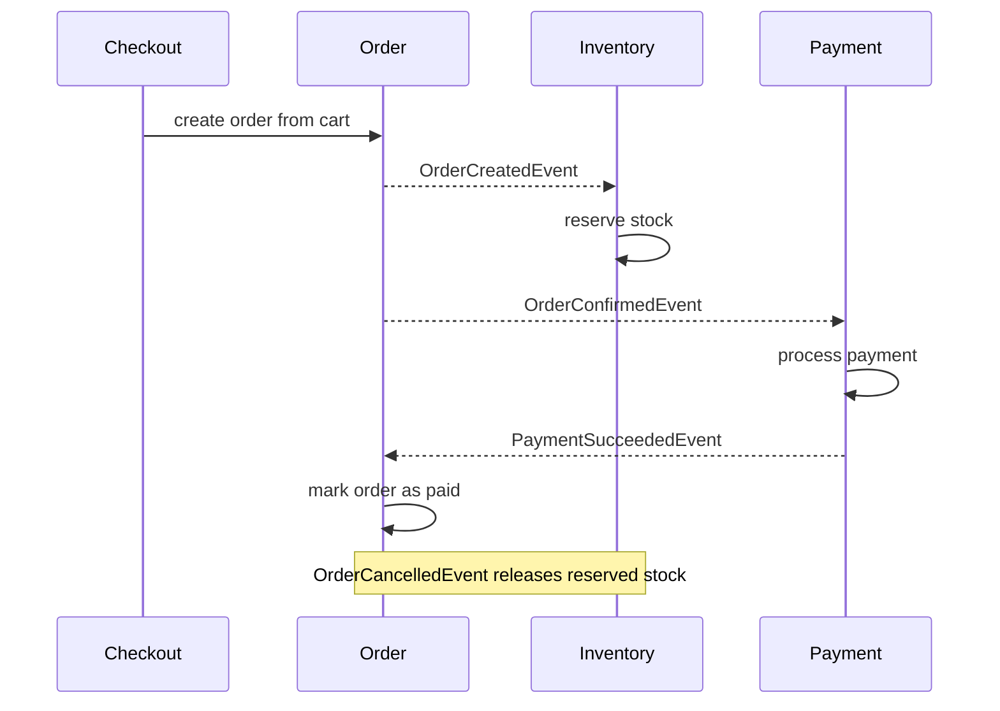

# E-commerce App

Backend e-commerce application built with Java and Spring Boot as a **modular monolith** using hexagonal architecture (ports and adapters) with DDD building blocks. The project is a hands-on exercise in designing clear module boundaries, event-driven communication, and a testable domain model.

## Features

- Product and category management with full-text product search (Elasticsearch)
- Customer management
- Shopping cart stored in Redis
- Checkout flow: cart -> order
- Order lifecycle: create, confirm, pay, ship, deliver, cancel
- Stock reservation and release in the inventory module
- Payment processing (simulated payment gateway)
- Asynchronous, event-driven communication between modules (RabbitMQ)
- Database migrations with Flyway
- Unit, controller, and integration tests

## Tech Stack

| Area | Technology |
|---|---|
| Language | Java 25 |
| Framework | Spring Boot 4 (Web MVC, Data JPA, Validation) |
| Database | PostgreSQL + Flyway |
| Cache / cart storage | Redis |
| Messaging | RabbitMQ |
| Search | Elasticsearch |
| Testing | JUnit, Testcontainers |
| Build / run | Maven, Docker, Docker Compose |

## Architecture

Each module follows the same layout:

```
<module>/
  domain/          # entities, value objects, repository interfaces (no framework code)
  application/     # use cases, DTOs, ports (interfaces to other modules and external systems)
  infrastructure/  # adapters: web controllers, JPA/Redis persistence, RabbitMQ, configuration
```

Key design decisions:

- **Domain independent of frameworks.** Business rules live in the domain model (e.g. `Order`, `Product`, `Cart`), not in controllers or services.
- **Repository interfaces in the domain, implementations in infrastructure.**
- **Typed identifiers and value objects** (`ProductId`, `OrderId`, `Money`) instead of raw primitives.
- **No direct dependencies between modules.** Modules talk through ports and adapters (e.g. `ProductCatalog`, `PaymentGateway`) or through events.
- **`checkout` module** orchestrates cart and order only through ports.
- **Shared kernel** (`shared/`) contains only `Money`, integration events, and the global exception handler.

### Modules

| Module | Responsibility |
|---|---|
| `catalog` | Categories, products, product search |
| `customer` | Customer management |
| `cart` | Shopping cart (Redis) |
| `checkout` | Turns a cart into an order |
| `order` | Order aggregate and lifecycle |
| `inventory` | Stock reservation and release |
| `payment` | Payment processing (simulated gateway) |

### Event flow



Product events (`ProductCreated`, `ProductUpdated`, `ProductDeleted`) are published by `catalog` to keep the search index and inventory in sync.

## Getting Started

### Requirements

- Docker
- Docker Compose

### Run

```bash
git clone https://github.com/melekv/java-ecommerce.git
cd java-ecommerce
docker compose up --build
```

### Run tests

Integration tests use Testcontainers, so Docker must be running.

```bash
cd spring
./mvnw test
```

## Project Status

This is a learning project. Currently simplified or not implemented:

- Payments use a fake gateway
- No authentication or authorization yet
- Test coverage is focused on the `catalog` and `order` modules

## Author

[melekv](https://github.com/melekv)
